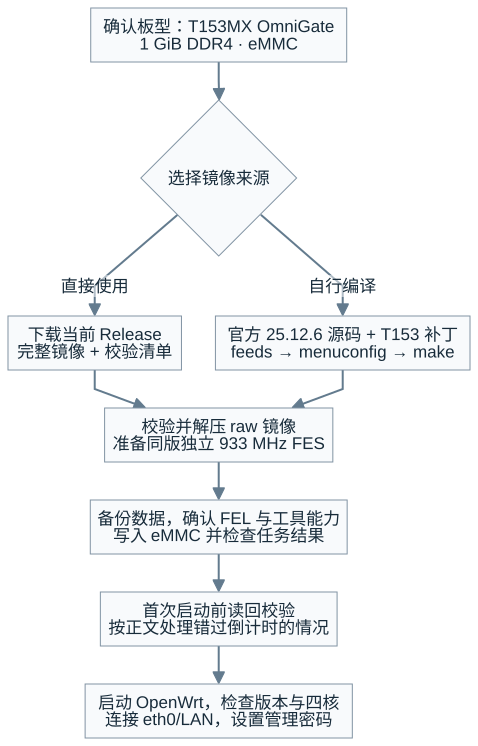
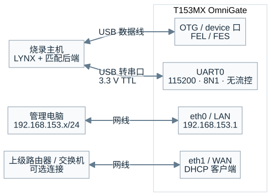
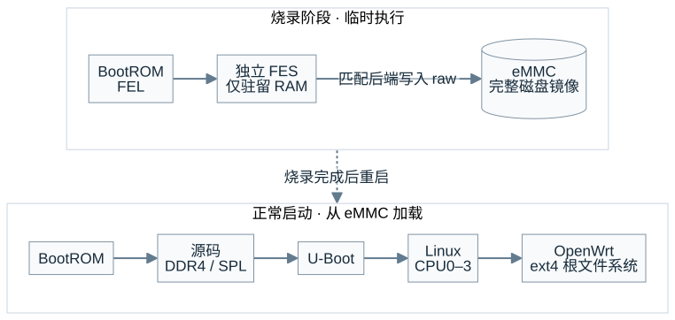

# OmniGate T153 · OpenWrt 25

**官方源码 + T153 板级补丁 · 四核 Cortex-A7 · eMMC 完整镜像**

基于官方 OpenWrt **25.12.6**，通过常规 `feeds`、`menuconfig` 和 `make` 自动构建 SPL、U-Boot、Linux 与 ext4 根文件系统。适用于 **DshanPI T153MX OmniGate / 1 GiB DDR4 / eMMC**。

[下载固件](https://github.com/dshanpi/OmniGate-T153-Openwrt25/releases/tag/v25.12.6-t153-preview.1) · [使用指南](docs/USER-GUIDE.md) · [自行编译](docs/USER-GUIDE.md#build) · [硬件资料](https://github.com/dshanpi/T153MX-Tina5SDK_OmniGate)

> [!IMPORTANT]
> 当前为 **`v25.12.6-t153-preview.1` 开发预览版**，板级适配尚未合入上游。Linux 可见内存为 **384 MiB**；WAN 千兆降至百兆的问题尚未解决，长期稳定性仍需验证。

## 从这里开始

| 要完成的任务 | 操作入口 |
| --- | --- |
| 首次安装系统 | [准备设备](docs/USER-GUIDE.md#prepare) → [下载校验](docs/USER-GUIDE.md#download) → [FEL/FES 烧录](docs/USER-GUIDE.md#fel) |
| 打开管理页面 | eth0/LAN → [http://192.168.153.1](http://192.168.153.1/) → [设置密码](docs/USER-GUIDE.md#luci) |
| 自定义软件包并编译 | [安装依赖、应用补丁、选择板型、构建镜像](docs/USER-GUIDE.md#build) |
| 排查启动或网络问题 | [启动验证](docs/USER-GUIDE.md#verify) · [LuCI 排查](docs/USER-GUIDE.md#63-处理无法访问页面) · [常见问题](docs/USER-GUIDE.md#troubleshooting) |

<details>
<summary>展开完整操作流程图</summary>



</details>

## 下载镜像与独立 FES

从同一个发布版本获取以下文件。完整镜像须解压为 `.img` 后烧录，FES 文件无需解压。

| 下载文件 | 用途 |
| --- | --- |
| [完整镜像 · ext4-raw.img.gz](https://github.com/dshanpi/OmniGate-T153-Openwrt25/releases/download/v25.12.6-t153-preview.1/openwrt-sunxi-cortexa7-dshanpi_t153mx-omnigate-ext4-raw.img.gz) | 包含持久启动链、内核和根文件系统 |
| [独立 FES · ddr933-ram-loader.img](https://github.com/dshanpi/OmniGate-T153-Openwrt25/releases/download/v25.12.6-t153-preview.1/t153-fes-ddr933-ram-loader.img) | 烧录时临时驻留 RAM，不写入 eMMC |
| [SHA256SUMS](https://github.com/dshanpi/OmniGate-T153-Openwrt25/releases/download/v25.12.6-t153-preview.1/SHA256SUMS) · [FES manifest](https://github.com/dshanpi/OmniGate-T153-Openwrt25/releases/download/v25.12.6-t153-preview.1/t153-fes-ddr933-ram-loader.manifest.json) | 文件校验与 loader 组成说明 |
| [T153 板级补丁](https://github.com/dshanpi/OmniGate-T153-Openwrt25/releases/download/v25.12.6-t153-preview.1/openwrt-25.12.6-t153.patch) | 用于官方 OpenWrt 25.12.6 源码归档 |

**先校验，再烧录。** 发布 raw 解压后为 **306184192 字节（292 MiB）**；FES 为 **1154048 字节**。完整文件名、SHA256 和 Windows 校验命令见 [下载与校验](docs/USER-GUIDE.md#download)。不要混用旧 snapshot 镜像。

## 通过 FEL/FES 烧录

> [!WARNING]
> 本流程覆盖 **eMMC 分区表和镜像区域**。先备份需要保留的数据并取出 SD 卡，确认目标板后再开始。

烧录使用 **LYNX MCP → 匹配的 OpenixCLI raw 后端**。需准备支持 T153 的后端及可连接的 MCP 服务；仅安装 LYNX 不代表配置完成，详见 [工具前置条件](docs/USER-GUIDE.md#prepare)。

1. 连接板卡 **OTG/device USB 口**，按硬件说明进入 FEL，确认 USB 标识 `1f3a:efe8`。
2. 扫描目标，确认 T153 SoC `0x1922` 和 `raw / command / verify / reboot` 能力。
3. 关闭占用串口的终端，按 [烧录请求](docs/USER-GUIDE.md#flash) 提交 **解压 raw + 独立 933 MHz FES**。
4. 轮询同一个 `taskId`，检查任务结果；不要重复提交烧录。
5. 按预先安排的串口接管方案中断 U-Boot，完成 [首次 Linux 启动前读回](docs/USER-GUIDE.md#verify)，再启动系统。

**任务通过条件：** `state=success`、`exitCode=0`、`verifyState=success`、`postFlashState=success`，且 `writtenBytes` 与 `committedBytes` 均等于 raw 实际长度。

FES 不拼入 raw，不单独刷入 eMMC，也不自行添加偏移。若已错过 U-Boot 倒计时且 Linux 已启动，记录“未完成初始整盘读回”；系统写盘后不能再用初始整盘 SHA256 判定烧录结果。

## 连接 LAN 并登录

| 接口 | 默认用途 | 管理入口 |
| --- | --- | --- |
| **eth0 / LAN** | `192.168.153.1/24`，向电脑分配地址 | [http://192.168.153.1](http://192.168.153.1/) |
| **eth1 / WAN** | DHCP 客户端，连接上级网络 | 默认不开放 LuCI |

电脑网卡设为自动获取 IPv4 地址。全新镜像管理员为 `root`，初始未设置密码；进入 LuCI 后，在 **系统 → 管理权** 设置密码。恢复过配置的设备使用恢复后的地址和密码。

<details>
<summary>查看接线与网络拓扑</summary>



烧录主机和管理电脑可以是同一台设备。图中表示连接用途，不表示引脚顺序或物理接口位置。

</details>

无法打开页面时，按 [链路 → 地址 → TCP 80 → 网页服务](docs/USER-GUIDE.md#63-处理无法访问页面) 的顺序排查。

## 从官方源码构建

在 **Ubuntu 24.04** 上使用普通用户，按 [完整编译步骤](docs/USER-GUIDE.md#build) 安装依赖、下载官方归档并应用 T153 补丁。无需 Tina SDK 或完整适配仓库副本。

补丁应用成功后，在源码根目录执行：

```bash
./scripts/feeds update -a &&
./scripts/feeds install -a &&
make menuconfig
```

| 菜单 | 选择值 |
| --- | --- |
| Target System | Allwinner ARM SoCs |
| Subtarget | Allwinner A20/A3x/H3/R40（cortexa7） |
| Target Profile | DshanPI T153MX OmniGate four-core Cortex-A7 (experimental) |

保存配置后编译：

```bash
make defconfig && make -j4
```

默认启用 ext4、256 MiB 根分区、LuCI/HTTPS，以及 AIC8800D80、EC20/ML302 相关驱动和工具。U-Boot 由板型依赖自动构建。保留官方固定 feeds 提交及补丁提供的版本文件。

成功时生成：

```text
bin/targets/sunxi/cortexa7/*-dshanpi_t153mx-omnigate-ext4-raw.img.gz
```

按 [产物检查](docs/USER-GUIDE.md#75-编译并确认产物) 校验、解压并记录 raw 的实际 SHA256 和长度。独立 FES 使用已校验的发布文件，不参与 OpenWrt 编译。

## 理解烧录与启动架构



持久 DDR4/SPL/U-Boot/内核由源码构建，不链接厂商 DDR 或 monitor 二进制。临时 FES 和无线固件仍含二进制，AIC 主机驱动为外部 GPL 源码。详见 [FES 来源](docs/FES-REPRODUCE.txt) 和 [四核架构](docs/T153-SMP.txt)。

## 核对验证范围

下表对应 **2026-11-05** 的 `v25.12.6-t153-preview.1` 记录。系统版本为 **25.12.6 / r33311-981c978eff**，Linux **6.12.112**，U-Boot **2026.07**。

| 功能 | 已有记录 | 待验证或限制 |
| --- | --- | --- |
| 四核 A7 | CPU0–3 在线，绑核并发计算短测通过 | 长期多核、DDR 压力 |
| eMMC | FES 写入、完整读回、ext4 可写启动通过 | 长期存储压力、物理断电冷启动 |
| LuCI / 有线网络 | 板上 localhost 登录页可返回 | 本版外部 LAN 未重测；WAN 降速未解决 |
| AIC8800D80 | 恢复配置后 AP 启动、蓝牙 HCI 运行 | 客户端吞吐、蓝牙配对与音频 |
| EC20 / ML302 | 已集成驱动和协议工具 | 本版模块识别、拨号和流量验收 |

当前不支持 **sysupgrade/LuCI 固件升级、CPU_OFF/CPU 热插拔、休眠和多核 kexec**。`sysupgrade -r` 仅恢复配置。普通软件重启已有记录；本版软件回 FEL 尚未完成独立验证。

## 查阅资料与反馈问题

| 资料 | 内容 |
| --- | --- |
| [客户使用指南](docs/USER-GUIDE.md) | 准备、下载、烧录、管理、编译与排查 |
| [原生构建记录](docs/OPENWRT-25.12.6-NATIVE.txt) | 当前版本的构建与验证依据 |
| [软件验证](docs/records/2026-11-05-native-image/README.txt) · [硬件验证](docs/records/2026-11-05-native-hardware/README.txt) | 镜像结构、读回、启动和四核短测 |
| [MCP 请求](host-tools/README.txt) · [FES 地址映射](docs/FES-RAW-MAPPING-CORRECTION.txt) | 烧录参数和偏移处理 |
| [Wi-Fi / 蓝牙](docs/AIC8800D80.txt) · [4G](docs/4G-EC20-ML302.txt) · [WAN 问题](docs/WAN-RTL8211F-RESET.txt) | 驱动配置和历史验证范围 |
| [许可](COPYING) · [来源说明](LICENSES) | 各组件许可与来源 |

[提交问题](https://github.com/dshanpi/OmniGate-T153-Openwrt25/issues) 时附上板型、发布标签、镜像/FES 的 SHA256 与长度、完整启动日志、烧录任务最终状态和复现步骤。不要提交密码、SIM 凭据或私有配置。

---

文档核对：**2026-11-12**。配图及 Mermaid 图源位于 [`docs/assets/guide/`](docs/assets/guide/)。历史 snapshot 记录不替代当前发布版验收。
