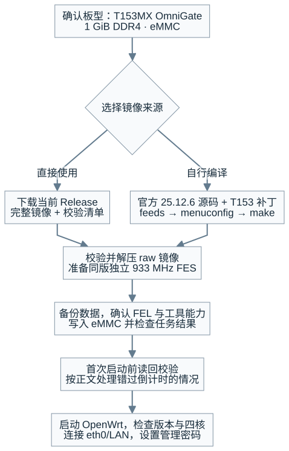
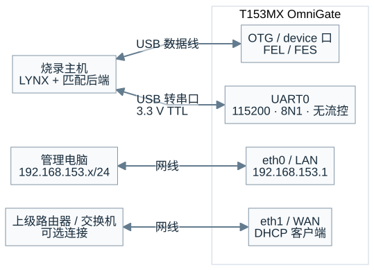
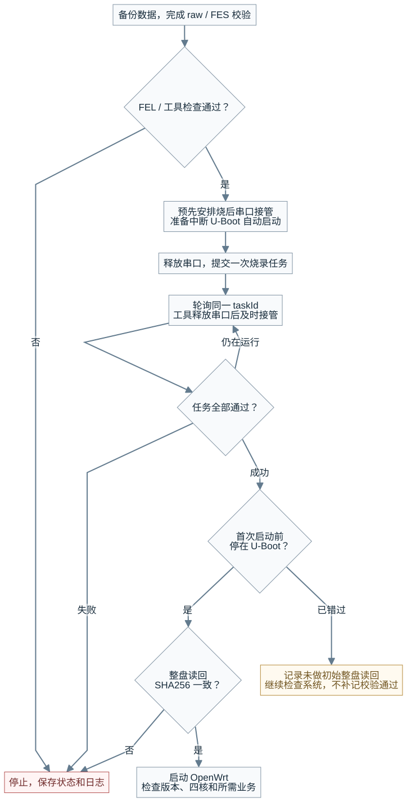
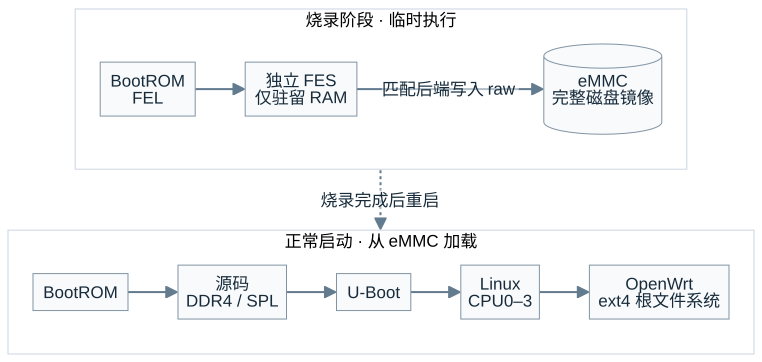
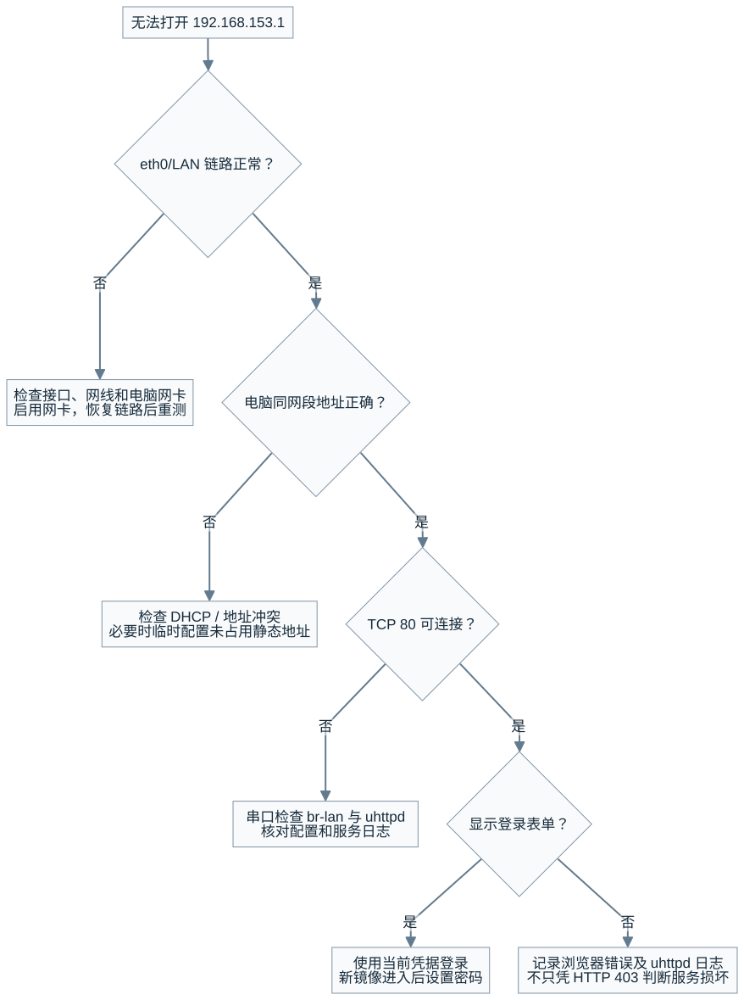
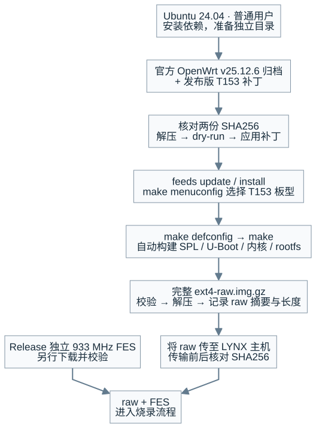

# OmniGate T153 · 使用指南

本文说明如何获取固件、通过 FEL/FES 写入 eMMC、访问 LuCI，以及使用官方 OpenWrt 源码编译 T153 镜像。

适用于 **DshanPI T153MX OmniGate、1 GiB DDR4、eMMC** 板卡，使用 `v25.12.6-t153-preview.1` 开发预览版。其它内存配置和板型不得直接套用本镜像。

[项目仓库](https://github.com/dshanpi/OmniGate-T153-Openwrt25) · [发布下载](https://github.com/dshanpi/OmniGate-T153-Openwrt25/releases/tag/v25.12.6-t153-preview.1)

快速入口与支持范围见 [仓库首页](../README.md)。首次烧录按本文顺序操作。

**适用版本：** `v25.12.6-t153-preview.1` · **文档核对：** 2026-11-12 · **实机记录：** 2026-11-05

> [!IMPORTANT]
> 本文对应开发预览版。当前 Linux 可见内存为 384 MiB，WAN 千兆降至百兆的问题尚未解决。已验证范围与后续验收要求见 [外设与支持范围](#peripherals)。

<a id="navigation"></a>

**操作导航**

[1. 准备设备](#prepare) · [2. 下载校验](#download) · [3. 进入 FEL](#fel) · [4. 烧录 eMMC](#flash) · [5. 验证启动](#verify)

[6. 登录 LuCI](#luci) · [7. 源码编译](#build) · [8. 检查外设](#peripherals) · [9. 故障排查](#troubleshooting) · [10. 保存记录](#records)

<details>
<summary>查看从获取镜像到启动管理的总流程</summary>



</details>

直接使用发布镜像时，从第 1 节开始；需要自定义软件包时，先完成第 7 节编译，再回到烧录步骤。

<a id="prepare"></a>

## 1. 准备板卡和操作环境

准备以下设备：

- T153MX OmniGate 板卡、符合板卡要求的电源和可传输数据的 USB 线。
- 安装 LYNX 的烧录主机，以及能连接其服务的 MCP 客户端。
- 3.3 V TTL USB 转串口模块，用于 UART0 启动日志和 U-Boot 操作。
- 网线和电脑网卡，用于连接板卡 LAN 口。
- 如需自行编译，准备 Ubuntu 24.04 构建主机。源码放在该 Linux 主机的独立目录，使用普通用户编译。

从 [LYNX 发布页](https://github.com/dshanpi/lynx-releases/releases/tag/v0.1.1) 获取与主机匹配的安装包；Windows 包名为 `LYNX_0.1.1_x64-setup.exe`。设备和串口绑定参考 [LYNX 使用说明](https://github.com/dshanpi/lynx-releases/blob/main/docs/user-guide.md)。

本项目已验证的是 **LYNX MCP → OpenixCLI raw command** 烧录方式。开始前，还须准备支持 T153 的匹配后端及已配置、可连接的 MCP 服务地址。公开的 LYNX 安装说明未覆盖 MCP 服务启用及本流程的全部配置；仅安装上述版本不能保证可以烧录。缺少后端或服务地址时，先向工具提供方取得配置，再按第 3 节检查能力。

本文中的两个 USB 连接用途不同：

| 连接 | 用途 | 检查条件 |
| --- | --- | --- |
| 板卡 USB OTG/device 数据口 → 烧录主机 | FEL 识别、FES 下载和镜像写入 | LYNX 扫描到目标 T153 |
| 板卡 UART0 → USB 转串口 → 主机 | 观察启动、操作 U-Boot/OpenWrt | 115200、8N1、无流控，能够接收日志 |
| 板卡 eth0/LAN → 电脑网卡 | 访问 LuCI | 电脑取得 `192.168.153.0/24` 地址并有链路 |



烧录主机与管理电脑可以是同一台电脑，WAN 不参与本地 LuCI 登录。图中仅说明连接用途，不表示引脚顺序或物理接口位置。

串口连接须共地，板卡 TX 接转串口 RX，板卡 RX 接转串口 TX。使用 3.3 V TTL 电平，不接 RS-232 电平；具体引脚位置以当前板卡丝印及硬件说明为准。

> [!WARNING]
> 烧录前备份需要保留的数据，并取出 SD 卡。本流程会覆盖 eMMC 分区表及镜像覆盖区域，不保留原厂分区布局，也不自动扩容剩余 eMMC 空间。

<a id="download"></a>

## 2. 下载并校验发布文件

### 2.1 选择同一个发布版本

打开 [v25.12.6-t153-preview.1 发布页](https://github.com/dshanpi/OmniGate-T153-Openwrt25/releases/tag/v25.12.6-t153-preview.1)，下载以下文件到同一目录。

| 文件 | 用途 |
| --- | --- |
| [完整镜像 `.img.gz`](https://github.com/dshanpi/OmniGate-T153-Openwrt25/releases/download/v25.12.6-t153-preview.1/openwrt-sunxi-cortexa7-dshanpi_t153mx-omnigate-ext4-raw.img.gz) | 完整磁盘镜像压缩包，包含持久启动区、内核和根文件系统 |
| [独立 FES `.img`](https://github.com/dshanpi/OmniGate-T153-Openwrt25/releases/download/v25.12.6-t153-preview.1/t153-fes-ddr933-ram-loader.img) | 独立 FES 引导文件，只在 RAM 中运行 |
| [FES manifest](https://github.com/dshanpi/OmniGate-T153-Openwrt25/releases/download/v25.12.6-t153-preview.1/t153-fes-ddr933-ram-loader.manifest.json) | FES 文件说明与组成记录 |
| [SHA256SUMS](https://github.com/dshanpi/OmniGate-T153-Openwrt25/releases/download/v25.12.6-t153-preview.1/SHA256SUMS) | 本次发布文件的 SHA256 校验清单 |

不要混用 `software-20261104`、`smp-preview-20261105` 的旧 snapshot 固件。发布镜像文件名没有版本号，版本以发布标签、校验值和系统内的版本信息为准。

以下示例在 **Windows 烧录主机的 PowerShell** 中执行，将文件保存到 `C:\T153\firmware`：

```powershell
New-Item -ItemType Directory -Force -Path 'C:\T153\firmware' | Out-Null
Set-Location 'C:\T153\firmware'
$t153ReleaseUrl = 'https://github.com/dshanpi/OmniGate-T153-Openwrt25/releases/download/v25.12.6-t153-preview.1'
$t153Files = @(
  'openwrt-sunxi-cortexa7-dshanpi_t153mx-omnigate-ext4-raw.img.gz',
  't153-fes-ddr933-ram-loader.img',
  't153-fes-ddr933-ram-loader.manifest.json',
  'SHA256SUMS'
)
foreach ($t153File in $t153Files) {
  Invoke-WebRequest -Uri "$t153ReleaseUrl/$t153File" -OutFile $t153File
}
```

### 2.2 校验压缩包和 FES

在同一个 PowerShell 目录执行：

```powershell
Get-FileHash -Algorithm SHA256 -LiteralPath `
  '.\openwrt-sunxi-cortexa7-dshanpi_t153mx-omnigate-ext4-raw.img.gz', `
  '.\t153-fes-ddr933-ram-loader.img'
```

结果须与 `SHA256SUMS` 中的同名条目一致。本文对应版本的关键值如下，大小写不影响比较：

```text
完整镜像压缩包
字节数：16560656
SHA256：aafef7198f0c5f68005471c30132b4a57334ae4d7e08c9ea5fcf9df5a68482ed

独立 FES 引导
字节数：1154048
SHA256：0d32d52139bc969f7f90665d32203ff07366ed0a31139bda607d89edbcd12873
```

任一校验值不一致时，停止烧录，重新下载对应文件。不要通过修改校验清单继续操作。

### 2.3 解压完整镜像

使用支持 gzip 的解压工具，例如 7-Zip，将 `.img.gz` 解压为：

```text
openwrt-sunxi-cortexa7-dshanpi_t153mx-omnigate-ext4-raw.img
```

FES 引导文件本身不需要解压。解压后在 PowerShell 执行：

```powershell
(Get-Item -LiteralPath '.\openwrt-sunxi-cortexa7-dshanpi_t153mx-omnigate-ext4-raw.img').Length
Get-FileHash -Algorithm SHA256 -LiteralPath `
  '.\openwrt-sunxi-cortexa7-dshanpi_t153mx-omnigate-ext4-raw.img'
```

发布版 raw 镜像的结果必须为：

```text
字节数：306184192（292 MiB）
SHA256：cd57d6970329f4a9255e7020ea3f7dfbc2c13040f7154563cbe43ba0d431a32e
```

以上固定值仅适用于该发布附件。自行修改配置并编译的镜像，应记录其实际 SHA256 和长度，不能使用发布附件的值代替。

<a id="fel"></a>

## 3. 进入 FEL 并检查烧录工具

### 3.1 让主机识别目标板

先将板卡 **USB OTG/device 数据口** 接入烧录主机，不使用普通 USB host 口。然后按当前板卡硬件说明操作 FEL/UPDATE 按键，并上电或复位；确认 USB 枚举后再松开按键。不同板卡批次的按键名称和操作可能不同，以当前硬件说明为准。

FEL 设备的 USB 标识为 `VID 1f3a / PID efe8`，Windows 硬件 ID 中可见 `VID_1F3A&PID_EFE8`。虚拟机作为烧录主机时，须将目标 USB 设备直通给该虚拟机。

通过正常 MCP 客户端连接 LYNX 服务，并完成初始化。`http://127.0.0.1:8771/mcp` 是本项目使用过的本机地址，仅在 LYNX 确实监听该地址时使用；远程服务应填写其实际地址。

### 3.2 检查目标与能力

以下是 **MCP 工具名与参数**，不是 PowerShell 或 Linux 命令。在 MCP 客户端依次调用：

| 工具 | 参数 | 检查内容 |
| --- | --- | --- |
| `lynx_workbench_status` | `{}` | 当前绑定的是待烧录板卡 |
| `lynx_flash_capabilities` | `{}` | 支持 `raw`、`command`、`verify`、`reboot` |
| `lynx_scan_flash_devices` | `{}` | 扫描到目标 T153，处于 FEL 状态 |

本板记录中的 SoC 标识为 `0x1922`，原始 chip 值为 `0x00192200`。不要仅根据历史设备名称判断目标。

未找到目标板、存在无法区分的多个目标，或工具能力不匹配时，不开始写入。

### 3.3 释放串口并检查 FES

关闭其它串口终端。MCP 客户端已打开本板串口时，先调用 `lynx_serial_close` 关闭该客户端创建的句柄。烧录预检需要独占串口读取存储信息，任务结束前不要重新占用。

在 MCP 客户端调用 `lynx_inspect_firmware`，参数示例：

```json
{
  "image_path": "C:\\T153\\firmware\\t153-fes-ddr933-ram-loader.img"
}
```

路径必须是 **LYNX 服务所在主机** 能访问的绝对路径。若 MCP 客户端和 LYNX 不在同一台电脑，不使用客户端自己的本地路径。

检查结果应为六个仅在 RAM 中使用的角色：`mbr-placeholder`、`sys-config`、`board-config`、`dtb-config`、`fes1`、`uboot`；不应包含要写入 eMMC 的厂商 kernel/rootfs。

不要用旧 1066 MHz loader、`physical0` loader 或源码 `-smp-fel.bin` 替代本文的独立 933 MHz FES。FES 不拼入 raw 镜像，也不单独写入 eMMC。

<a id="flash"></a>

## 4. 写入 eMMC 并检查任务结果



串口接管须预先安排，并与任务查询配合；不能等最终成功状态出现才开始准备连接。烧录期间不占用工具使用的串口，工具释放后再接管。

图中“任务全部通过”指写入、校验和重启状态成功，且写入与提交字节数均等于实际 raw 长度，具体字段见第 4.2 节。

### 4.1 提交一次烧录任务

确认已经完成备份，且目标板、两个文件及其校验均正确。

如需进行第 5.1 节的初始整盘读回校验，提交前须安排好任务释放串口后的接管与 U-Boot 中断操作。下列请求会在烧录后自动重启；仅在看到最终成功状态后才开始准备串口，可能错过倒计时。烧录期间仍须让工具独占串口。

在 MCP 客户端调用 `lynx_start_flash`：

```json
{
  "firmwarePath": "C:\\T153\\firmware\\openwrt-sunxi-cortexa7-dshanpi_t153mx-omnigate-ext4-raw.img",
  "confirmDestructive": true,
  "options": {
    "mode": "command",
    "verify": true,
    "postFlashAction": "reboot",
    "vendorOptions": {
      "raw": true,
      "loaderPath": "C:\\T153\\firmware\\t153-fes-ddr933-ram-loader.img"
    }
  }
}
```

`confirmDestructive: true` 表示确认覆盖所选 eMMC 的分区表和镜像区域。`firmwarePath` 必须指向解压后的完整 `.img`，不能使用 `.img.gz`、单独 rootfs、FIT 或 initramfs。

保持 FES 原始映射，由匹配的 OpenixCLI raw 后端处理地址补偿。不要自行增减写入偏移，也不要叠加 `physical0` 修正。

### 4.2 轮询同一个任务

保存返回的 `taskId`，调用 `lynx_workbench_task_status`：

```json
{
  "taskId": "替换为本次烧录返回的 taskId"
}
```

任务运行期间继续查询同一个 ID，不重复调用 `lynx_start_flash`。完成后必须同时满足：

| 字段 | 发布镜像的要求 |
| --- | --- |
| `state` | `success` |
| `exitCode` | `0` |
| `verifyState` | `success` |
| `postFlashState` | `success` |
| `writtenBytes` | `306184192` |
| `committedBytes` | `306184192` |

仅显示进度 100% 或传输完成，不等于写入和校验通过。任务报错、取消、长度不符或校验失败时，保存完整状态与日志并停止，不自动重复烧录。

烧录结束后工具会执行软件重启。按预先安排的接管方式，在任务释放串口后连接调试串口并中断 U-Boot 自动启动。若已错过倒计时且 Linux 已启动，跳至第 5.2 节检查系统，并记录“未完成首次启动前整盘读回校验”；不能把重新启动后的读回补记为该项通过。

<a id="verify"></a>

## 5. 核对写入内容并检查启动



FES 不参与刷机完成后的正常启动。以下检查针对 eMMC 中本次写入的完整 raw 镜像。

### 5.1 在首次 Linux 启动前读回校验

通过 UART0、115200、8N1、无流控观察启动，在 U-Boot 自动启动倒计时内按键进入命令行。

先执行以下命令，确认 `mmc 1` 是本板 eMMC 的 user area。不能仅凭设备编号继续操作：

```text
mmc list
mmc dev 1
mmc info
```

确认目标后，仅对本文默认 **292 MiB** 镜像执行：

```text
if mmc read 48000000 0 92000; then hash sha256 48000000 12400000; fi
```

这里 `92000` 和 `12400000` 是十六进制，分别表示 598016 个扇区和 306184192 字节。读回 SHA256 必须等于本次解压 raw 文件的 SHA256；发布附件对应值见第 2.3 节。

读回失败或 SHA256 不一致时，保存日志并停止验收。FES 层校验不能替代该读回结果。

此检查须在 Linux 首次启动写入文件系统前进行。系统已经启动、保存配置或产生运行数据后，整盘 SHA256 可能变化，不能再直接与初始镜像对比并据此判定烧录失败。

自行调整根分区大小后，不要照搬上述读取范围，也不要在同一 RAM 地址读入更大镜像；须根据实际镜像长度和可用内存另行制定读回方法。

### 5.2 启动 OpenWrt

校验通过后，在 U-Boot 执行：

```text
run bootcmd
```

进入 OpenWrt 串口终端后执行：

```sh
cat /etc/openwrt_release
uname -r
cat /sys/devices/system/cpu/online
grep -c '^processor' /proc/cpuinfo
grep ' / ' /proc/mounts
```

本文发布版本的预期结果：

| 检查项 | 预期结果 |
| --- | --- |
| OpenWrt 版本 | `25.12.6` |
| 系统 revision | `r33311-981c978eff` |
| Linux 内核 | `6.12.112` |
| CPU online | `0-3` |
| processor 数量 | `4` |
| 根文件系统 | `/dev/root`，`ext4`，挂载选项包含 `rw` |

出现旧 snapshot 版本、只有 CPU0 或根分区未挂载时，先核对镜像和启动日志，不将其记为本版启动通过。

<a id="luci"></a>

## 6. 连接 LAN 并登录 LuCI

### 6.1 连接正确的网口

默认网络设置如下：

| 板卡接口 | 用途 | 默认设置 |
| --- | --- | --- |
| `eth0` | LAN，连接管理电脑 | `192.168.153.1/24` |
| `eth1` | WAN，连接上级网络 | DHCP 客户端；默认拒绝 WAN 网页管理 |

将电脑网卡接到 **eth0/LAN**，启用网卡并设置为自动获取 IPv4 地址。使用 USB 网卡时，先确认它已被系统识别且未被禁用。

在 Windows PowerShell 执行：

```powershell
Get-NetAdapter
ipconfig
ping 192.168.153.1
Test-NetConnection 192.168.153.1 -Port 80
```

电脑应取得 `192.168.153.x` 地址，子网掩码为 `255.255.255.0`。若 DHCP 暂未取得地址，可在该网卡上临时配置一个未占用地址，例如 `192.168.153.2/24`；仅用于直连管理时可不填写默认网关。测试完成后按实际网络需要恢复自动获取。

### 6.2 初始化管理密码

浏览器打开：

<http://192.168.153.1/>

全新发布镜像的管理员为 `root`，初始未设置密码。进入后立即在 **系统 → 管理权** 设置管理员密码，也可在板卡串口执行：

```sh
passwd
```

已恢复旧配置的设备使用恢复后的地址和密码，不能再套用全新镜像的初始登录条件。不要用 WAN 获得的地址作为默认 LuCI 入口。

### 6.3 处理无法访问页面



图中地址适用于全新默认配置；已恢复配置的设备先通过串口确认实际 LAN 地址。

按以下顺序检查：

1. 电脑连接的是 eth0/LAN，网卡已启用，链路状态正常。
2. 电脑地址处于 `192.168.153.0/24`，与板卡地址不冲突。
3. TCP 80 端口可连接。仅能 ping 通不能证明网页服务可用。
4. 通过板卡串口检查 LAN、链路和网页服务：

```sh
ip addr show br-lan
ubus call network.interface.lan status
ethtool eth0
/etc/init.d/uhttpd status
logread -e uhttpd
```

`carrier` 为 0 或 `Link detected: no` 时，先检查网口连接与电脑网卡状态。端口可达但页面异常时，记录浏览器错误及服务日志。未登录响应可能带有 `x-luci-login-required: yes` 和登录表单，不应只根据 HTTP 403 就判断 LuCI 损坏。

<a id="build"></a>

## 7. 从官方源码编译镜像（可选）

本节在 **Ubuntu 24.04 构建主机** 执行。使用官方源码归档和一个 T153 补丁即可，不需要 Tina SDK，也不需要克隆完整适配仓库。



任一校验、补丁或编译步骤失败，停止后续操作并按本节检查。FES 单独下载，不参与 OpenWrt 编译，也不拼入 raw 镜像。

### 7.1 安装依赖

```bash
sudo apt-get update
sudo apt-get install build-essential clang flex bison gawk gcc-multilib \
  g++-multilib gettext git libncurses-dev libssl-dev libelf-dev \
  python3 python3-dev python3-setuptools python3-pyelftools \
  rsync swig unzip zlib1g-dev file wget curl ca-certificates patch \
  xz-utils bzip2 zstd time pkg-config
```

后续下载、配置和编译使用普通用户，不使用 `sudo make`。

### 7.2 获取并校验源码与补丁

选择不在其它 Git 仓库内部的独立目录。以下以 `~/t153-build` 为例；已有同名源码目录时，不覆盖正在使用的构建目录。

```bash
mkdir -p ~/t153-build &&
cd ~/t153-build &&

curl --fail --location --output openwrt-v25.12.6.tar.gz \
  https://codeload.github.com/openwrt/openwrt/tar.gz/refs/tags/v25.12.6 &&

curl --fail --location --output openwrt-25.12.6-t153.patch \
  https://github.com/dshanpi/OmniGate-T153-Openwrt25/releases/download/v25.12.6-t153-preview.1/openwrt-25.12.6-t153.patch &&

sha256sum -c <<'EOF'
f5ff8258572a82df960470608ceb025655a42bc94b8e7e2a77a4373db46263d9  openwrt-v25.12.6.tar.gz
338dc6fbc70663a73416e984f1c148b0d5bfd02793294ef13160efd353889690  openwrt-25.12.6-t153.patch
EOF
```

两个文件均须显示 `OK`。任一下载或校验失败时，停止，不执行第 7.3 节。源码归档的摘要是项目对该官方来源归档的实算记录，不是上游独立签发的校验文件。

### 7.3 应用 T153 补丁

```bash
test ! -e openwrt-25.12.6 &&
tar -xzf openwrt-v25.12.6.tar.gz &&
cd openwrt-25.12.6 &&
patch --dry-run -p1 < ../openwrt-25.12.6-t153.patch &&
patch -p1 < ../openwrt-25.12.6-t153.patch
```

已有 `openwrt-25.12.6` 目录时，上述命令停止，不覆盖已有源码。预检查失败时不执行实际应用；实际应用不得出现 `FAILED` 或 `.rej` 文件。核对版本和文件校验后，重新使用干净的源码目录操作，不强制忽略补丁错误。

保留补丁提供的 `version`、`version.date` 及归档原有时间信息，不把源码放在其它 Git 仓库内部，以免构建系统错误采用父仓库版本信息。

### 7.4 更新 feeds 并选择板型

在 `openwrt-25.12.6` 目录执行：

```bash
./scripts/feeds update -a &&
./scripts/feeds install -a &&
make menuconfig
```

保持官方 `feeds.conf.default` 的固定提交，不改为 `master` 或浮动分支。在菜单中选择：

| 项目 | 选择值 |
| --- | --- |
| Target System | Allwinner ARM SoCs |
| Subtarget | Allwinner A20/A3x/H3/R40（cortexa7） |
| Target Profile | DshanPI T153MX OmniGate four-core Cortex-A7 (experimental) |

Subtarget 的菜单标题虽然没有列出 T153，`cortexa7` 仍是本板正确选项。看不到该 profile 时，先检查补丁是否完整应用。

默认选择 ext4 根文件系统和 256 MiB 根分区，并包含 LuCI/HTTPS、AIC8800D80、EC20/ML302 相关驱动与工具。可以按需要增删软件包；调整根分区时保留 ext4。U-Boot 会由板型依赖自动编译，无需手动安装到 rootfs。

### 7.5 编译并确认产物

保存配置后执行：

```bash
make defconfig &&
(
  set -o pipefail
  if make -j4 2>&1 | tee build.log; then
    printf '%s\n' '构建成功：继续检查完整镜像。'
  else
    printf '%s\n' '构建失败：停止烧录，检查 build.log。'
    exit 1
  fi
)
```

成功条件为 `make` 返回 0，且生成完整镜像。失败时保留日志，再使用单任务详细输出定位：

```bash
(
  set -o pipefail
  make -j1 V=s 2>&1 | tee build-error.log
)
```

产物目录为：

```text
bin/targets/sunxi/cortexa7/
```

在构建目录执行以下检查：

```bash
ls -lh bin/targets/sunxi/cortexa7/*-dshanpi_t153mx-omnigate-ext4-raw.img.gz &&
cd bin/targets/sunxi/cortexa7 &&
sha256sum -c sha256sums --ignore-missing
```

确认实际文件名后解压。默认文件名示例：

```bash
gzip -dk openwrt-sunxi-cortexa7-dshanpi_t153mx-omnigate-ext4-raw.img.gz
sha256sum openwrt-sunxi-cortexa7-dshanpi_t153mx-omnigate-ext4-raw.img
stat -c %s openwrt-sunxi-cortexa7-dshanpi_t153mx-omnigate-ext4-raw.img
```

保存 `.config`、构建日志、`config.buildinfo`、`feeds.buildinfo`、`version.buildinfo`、manifest、校验清单及 raw 的 SHA256/长度。

默认 256 MiB 根分区对应 292 MiB 整盘镜像；根分区为 R MiB 时，整盘为 R + 36 MiB。自定义镜像须使用实际长度检查烧录结果，并重新安排读回验证范围。

将解压后的 raw 镜像复制到 LYNX 主机，传输前后核对 SHA256，再按第 3～5 节烧录。独立 FES 文件沿用已校验的发布文件，不参与 OpenWrt 编译。

<a id="peripherals"></a>

## 8. 识别外设并确认支持范围

在板卡 OpenWrt 终端检查实际设备：

```sh
iw dev
hciconfig -a
lsusb
lsusb -t
ls -l /dev/cdc-wdm* /dev/ttyUSB* 2>/dev/null
```

这些命令用于确认设备或驱动状态，不能单独证明无线吞吐、蓝牙业务或 4G 联网已通过。

| 功能 | 该发布版本已有记录 | 仍需按实际设备验收 |
| --- | --- | --- |
| 四核 A7 | CPU0–3 在线，绑核并发计算短测通过 | 长期多核、DDR 和存储压力 |
| Wi-Fi | 恢复配置后的 AP 已启动 | 客户端连接、吞吐与恢复能力 |
| 蓝牙 | HCI 控制器 `UP RUNNING` | 配对、音频和业务传输 |
| EC20/ML302 | 已集成相关驱动和协议工具；本轮未接入模块 | SIM 注册、APN、拨号及流量 |
| LuCI | 板上 localhost 登录页可返回 | 本轮未重新验证电脑经外部 LAN 访问 |

EC20/ML302 须按实际 USB 模式选择 QMI、MBIM、ECM/RNDIS 或串口协议。不要只凭商品名称或 `/dev/ttyUSB` 编号选择拨号配置。配置方法见 [4G 使用说明](https://github.com/dshanpi/OmniGate-T153-Openwrt25/blob/main/docs/4G-EC20-ML302.txt)，其中旧 snapshot 的测试结果不能替代本版本拨号验收。

<a id="troubleshooting"></a>

## 9. 处理常见问题

<details>
<summary>扫描不到 FEL</summary>

检查数据线、板卡 FEL 操作和 USB 直通；以当前扫描结果为准，不仅看串口状态。

</details>

<details>
<summary>烧录预检无法读取 eMMC 信息</summary>

关闭其它串口终端和已有 MCP 串口句柄，再检查目标、服务能力及日志。

</details>

<details>
<summary>出现 0xffffxxxx 扇区越界</summary>

停止写入；检查是否混用旧 loader 或叠加 `physical0` 偏移，恢复本文匹配的 FES/raw 流程。

</details>

<details>
<summary>下载或读回校验不一致</summary>

保存两侧 SHA256、长度和日志，停止验收；不反复写入尝试掩盖问题。

</details>

<details>
<summary>系统启动后整盘 SHA256 改变</summary>

确认是否已经发生文件系统写入；初始镜像读回比较必须在 Linux 首次启动之前完成。

</details>

<details>
<summary>WAN 从千兆降到百兆或反复协商</summary>

这是仍未解决的问题；记录链路和内核日志，不将百兆连通写成千兆稳定通过。

</details>

<details>
<summary>LuCI 无法打开</summary>

按第 6.3 节检查 LAN 链路、电脑地址和网页端口；默认不通过 WAN 管理。

</details>

<details>
<summary>Linux 可用内存少于 1 GiB</summary>

当前镜像保留 384 MiB 可见窗口，不表示已开放全部物理内存。

</details>

<details>
<summary>希望通过 LuCI 上传固件升级</summary>

本版未支持该方式；使用完整 raw 镜像与 FES 重新烧录，事先保存配置。

</details>

本版不支持 CPU_OFF/CPU 热插拔、休眠和多核 kexec。`sysupgrade -r` 仅用于恢复配置，不表示支持 `sysupgrade` 固件写入。

旧四核 snapshot 曾验证软件回 FEL；**本版该路径尚未完成独立验证**。不能把执行 `reboot efex` 等同于已经进入 FEL，应重新扫描确认；没有 FEL 枚举时使用板卡硬件入口，不自行填写寄存器地址绕过检查。

<a id="records"></a>

## 10. 保存结果并查阅原始资料

每轮操作至少保留：镜像与 FES 的 SHA256/大小、最终烧录任务状态、首次 Linux 启动前的读回 SHA256、完整启动日志、系统版本、CPU online 和所需网络/外设检查结果。

本项目是尚未合入上游的实验性板级适配。持久 DDR4/SPL/U-Boot/内核由源码构建；临时 FES 和无线固件仍含二进制。烧录成功、系统启动和长期稳定性是不同结论，应分别记录。

- [版本与发布附件](https://github.com/dshanpi/OmniGate-T153-Openwrt25/releases/tag/v25.12.6-t153-preview.1)
- [完整构建与烧录依据](https://github.com/dshanpi/OmniGate-T153-Openwrt25/blob/main/docs/OPENWRT-25.12.6-NATIVE.txt)
- [MCP 参数说明](https://github.com/dshanpi/OmniGate-T153-Openwrt25/blob/main/host-tools/README.txt)
- [完整 JSON-RPC 请求模板](https://github.com/dshanpi/OmniGate-T153-Openwrt25/blob/main/host-tools/mcp-fes-workflow.example.json)
- [本版本实机验证记录](https://github.com/dshanpi/OmniGate-T153-Openwrt25/blob/main/docs/records/2026-11-05-native-hardware/validation.json)
- [FES 地址映射问题说明](https://github.com/dshanpi/OmniGate-T153-Openwrt25/blob/main/docs/FES-RAW-MAPPING-CORRECTION.txt)
- [AIC8800D80 支持范围](https://github.com/dshanpi/OmniGate-T153-Openwrt25/blob/main/docs/AIC8800D80.txt)
- [OmniGate 硬件资料](https://github.com/dshanpi/T153MX-Tina5SDK_OmniGate)

本指南依据适配仓库提交 `6d6f9236fdabe89844747334c5aea00744afd64a` 及对应 Release 编写。更新固件后，应重新核对文件名、校验值、工具接口与验收记录。

配图和可编辑 Mermaid 图源位于 [`assets/guide/`](assets/guide/)。复制文档时一并保留配图目录。

[返回操作导航](#navigation) · [返回仓库首页](../README.md)
